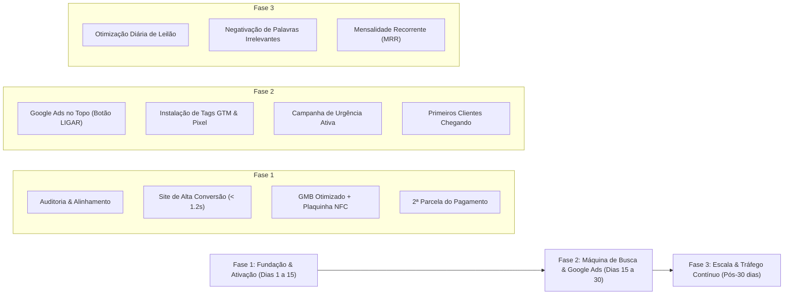

# Padrão Rhenan — Propostas Comerciais e Roadmaps de Alta Conversão (Método One-Pager & 3-Page A4)

> Framework oficial do Rhenan para criação de propostas, roadmaps de implantação e fechamento de novos clientes. Baseado no modelo validado de alta conversão com ancoragem profunda, eliminação de atrito financeiro, gatilhos de urgência real e formato estrito de 3 páginas A4.

---

## 1. Os 10 Pilares Estruturais da Proposta

| # | Pilar | Objetivo Psicológico / Comercial | Aplicação Prática |
|---|-------|----------------------------------|-------------------|
| 1 | **Formato Cirúrgico** | Leitura em menos de 2 minutos | PDF de 3 páginas A4 exatas (ou One-Pager interativo) com botão de clique direto pro WhatsApp. |
| 2 | **Personalização & Rapport** | Mostrar exclusividade e dedicação | Citação da fundação real, tempo de mercado, nota e número exato de avaliações no Google Maps. |
| 3 | **Justificativa do Desconto** (*Reason Why*) | Evitar que o preço pareça inflado | "Como estamos estruturando a expansão no seu bairro agora, liberamos a condição de parceiro fundador com raio de exclusividade..." |
| 4 | **Escassez Real com Prazo Fatal** | Evitar que a proposta esfrie na gaveta | Caixa de urgência: `⏳ Condição válida por 48h a 72h (data e hora exatas)`. Após essa data, abrimos para outro concorrente do bairro. |
| 5 | **Ancoragem Brutal de Preço** | Fazer o investimento parecer irrisório perante o retorno | Valor avulso somado riscado (~R$ 6.800,00~) vs. Valor da oportunidade (**R$ 2.000,00**) + Economia de R$ 4.800,00. |
| 6 | **Engenharia de Fluxo de Caixa** | Quebrar a objeção "não tenho essa grana agora" | Entrada/sinal + 15 dias de fôlego + parcelas mensais sem juros (ou 4x no cartão/boleto). |
| 7 | **Empilhamento de Bônus de Ativação** | Deixar a oferta irresistível | Bônus 1: Site/Biosite de Alta Conversão (< 1.2s)<br>Bônus 2: Ficha GMB Otimizada 360º + Plaquinha NFC física de balcão<br>Bônus 3: Gestão de respostas para 100% das avaliações. |
| 8 | **Linguagem de Alívio & Benefício** | Vender clientes na porta, não código | Usar "clientes com urgência ligando pro balcão", "estanca a perda de clientes pro concorrente", "zero trabalho pra sua equipe". |
| 9 | **CTA 1-Clique no WhatsApp** | Fechamento imediato sem burocracia | Botão proeminente `[ ✅ Quero destravar minha empresa agora ]` com link direto `https://wa.me/5521973152056`. |
| 10 | **Recorrência & Blindagem de Custos** | Gerar MRR e proteger a agência | Menção clara da gestão mensal contínua à parte; fine print estipulando que verba de anúncios do Google/Meta e domínio são pagos direto pelo cliente. |

---

## 2. Estrutura Padrão do Roadmap de 3 Fases



---

## 3. Roteiro de Envio no WhatsApp (Script Validado)

Ao enviar o PDF no WhatsApp (direto com o sócio ou no grupo dos decisores):

```markdown
Fala {Sócio}, tudo bem?

Conforme conversamos, segue o Roadmap e proposta estratégica da {Empresa}, com o plano de ação em 3 fases para destravar novos clientes no topo do Google.

Esta condição especial com os bônus inclusos é por tempo limitado (válida por 48h, até {Dia}, {Data}, às 23h59), para garantirmos o raio de exclusividade no seu bairro.

Dá uma olhada no PDF anexo e, para confirmar o início ainda esta semana, é só tocar no botão verde dentro do documento ou me dar um OK por aqui! 🚀
```

---

## 4. Cláusula Obrigatória de Blindagem (Fine Print)

Sempre incluir no rodapé de toda proposta e roadmap do Rhenan:

> *"Domínio próprio, hospedagem e verba direta de anúncios ficam a cargo do contratante, pagas diretamente às plataformas (Google Ads e Meta Ads). Módulos, páginas e integrações fora do escopo apresentado são orçados à parte. Condição comercial e raio de exclusividade garantidos mediante aprovação formal dentro do prazo de validade estipulado."*

---

## 5. Contato & Assinatura Oficial

- **Especialista:** Rhenan · Assessoria & Performance Digital
- **WhatsApp Oficial:** (21) 97315-2056
- **Link Direto:** `https://wa.me/5521973152056`
